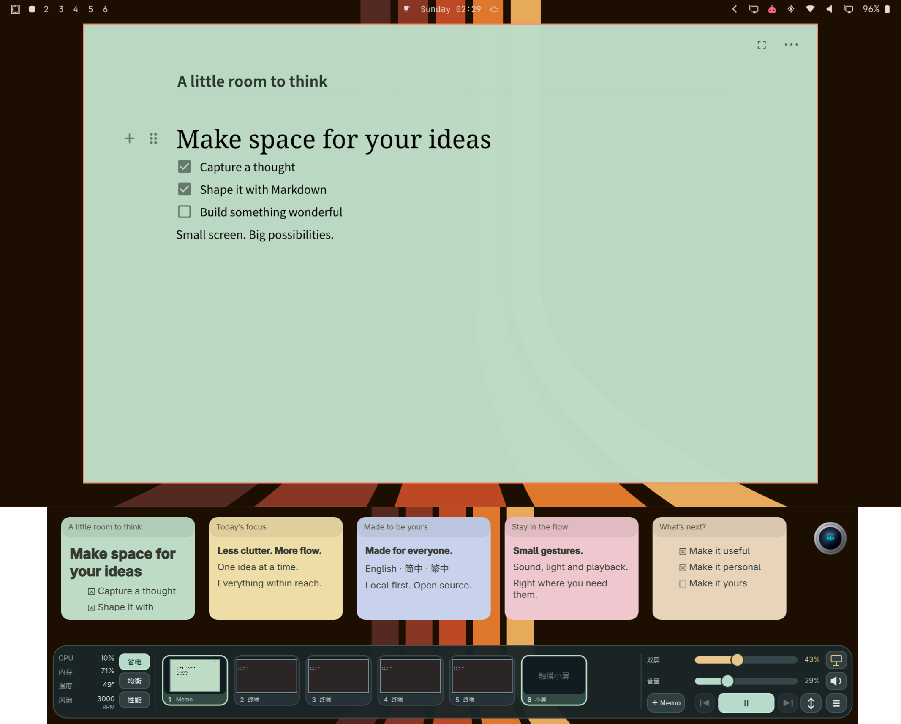
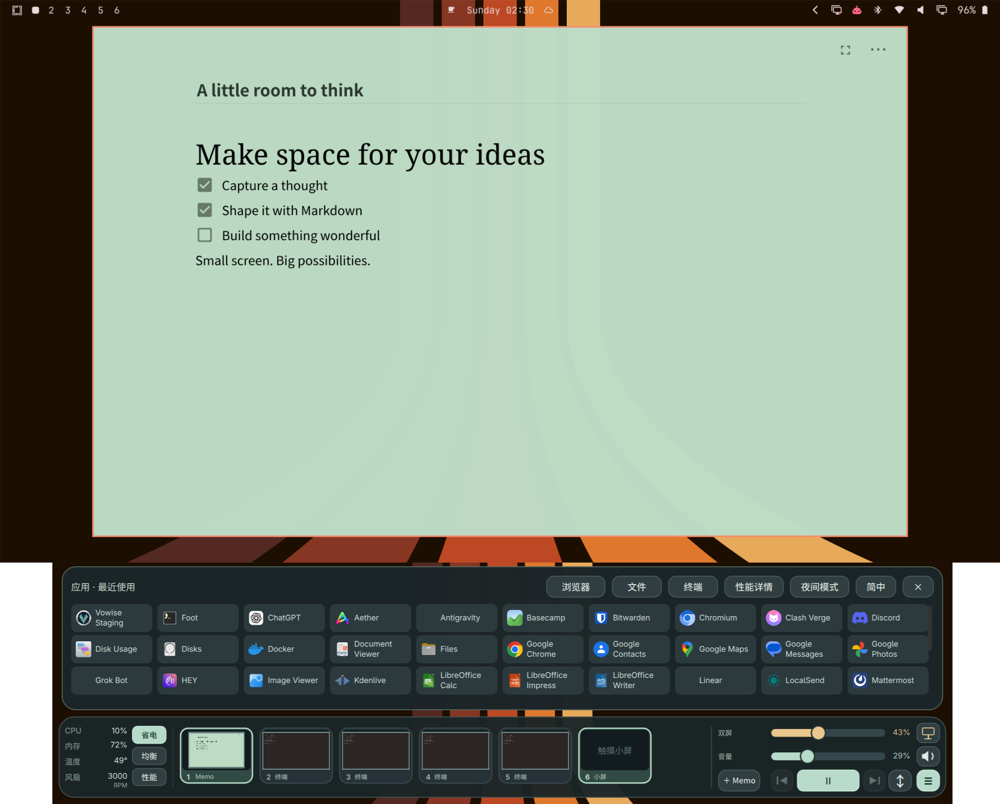

# DuoDeck

**把工作区、桌面控制和本地 Markdown 便签，放进一个适合触控的 Omarchy Dock。**

[English](README.md) · [简体中文](README.zh-CN.md) · [繁體中文](README.zh-TW.md)

[](https://github.com/quedulex/duodeck/actions/workflows/check.yml)
[](https://github.com/quedulex/duodeck/releases)
[](LICENSE)
[](https://github.com/quedulex/duodeck/stargazers)

[快速开始](#快速开始) · [功能](#功能) · [配置](#配置) · [参与贡献](CONTRIBUTING.md) · [版本发布](https://github.com/quedulex/duodeck/releases)


*29 秒循环动图，直接在本页展示。跨屏展开需要单独配置的 ASUS 适配器。*

**[高清 MP4 视频](docs/videos/duodeck-demo.mp4)** · [中英文截图画廊](docs/MEDIA.md)

## 为什么使用 DuoDeck？

让常用桌面操作集中在宽屏触控设备或笔记本副屏上。切换工作区、启动最近使用的应用、调节音量与亮度、随手写便签，无需分别搭建多个桌面小组件。

DuoDeck 是原生 **Omarchy Quattro 服务插件**。Dock 运行在现有 Shell 中，便签编辑器使用独立的 Chromium 应用窗口。**0.1.2 为预览版**，面向约 **1100 逻辑像素及以上**的宽屏。

## 功能

| 功能 | 可以做什么 |
| --- | --- |
| 工作区预览 | 查看缩略图并直接切换工作区；超出宽度时横向滚动。 |
| 最近应用启动器 | 使用适合触控的应用菜单，按本地启动和窗口激活记录排序。 |
| 桌面控制 | 调节音量、亮度，静音，控制媒体播放，切换电源模式。 |
| 系统状态 | 查看 CPU、内存、温度和风扇读数，具体取决于设备传感器。 |
| 本地 Markdown 便签 | 创建彩色卡片，用 Milkdown Crepe 编辑，自动保存、归档、恢复和导出 Markdown。 |
| 三种界面语言 | 在英语、简体中文和繁体中文之间切换。 |

## 实际效果

| 工作区预览与本地便签 | 应用菜单与桌面控制 |
| --- | --- |
| [](docs/screenshots/zh-01-dual-screen.png) | [](docs/screenshots/zh-02-menu.png) |

[操作视频](docs/videos/duodeck-demo.mp4)展示打开应用菜单、拖动卡片、打开演示便签、跨屏展开与恢复。画面只展开空白 Antigravity 和演示便签，其他应用保留为小型工作区缩略图。视频没有音频。

**截图和视频中的跨屏功能使用单独配置的 ASUS 适配器，通用安装默认不会启用。** 应用图标、壁纸、顶部栏和圆形语音组件属于周边桌面。更多中英文画面、全屏效果和实机照片见[完整画廊](docs/MEDIA.md)。

## 快速开始

### 环境要求

需要 **Omarchy Quattro** 及其插件系统、**Hyprland Lua dispatch API**、Quickshell 和 Python 3。不支持仅提供旧式字符串 dispatch 的 Hyprland 版本。

| 功能 | 依赖 |
| --- | --- |
| 原生 Dock | Quickshell 的 Hyprland、Wayland screencopy、MPRIS 模块；Qt Quick Controls |
| 音量、背光、电源模式 | `wpctl`、`brightnessctl`、`powerprofilesctl` |
| 启动应用与快捷入口 | `uwsm-app`、`gtk-launch`、Omarchy 命令；文件与监控入口分别使用 Nautilus、`btop` |
| Markdown 编辑器 | `chromium`、Python 3；编辑器资源随插件提供 |

插件不会自动安装依赖。缺少传感器时显示短横线。完整依赖与合成器行为见[详细参考（英语）](docs/REFERENCE.md)。

### 安装并启用

```sh
omarchy plugin add https://github.com/quedulex/duodeck --enable
```

只启用一个实例。已有开发版正在运行时，先用 `omarchy plugin list` 找到它的 ID 并停用。如果使用过独立的 `touch-console.service`，请先停止该服务。安装过程不会自动停止其他服务或改写桌面配置。

### 使用

1. 点击工作区卡片切换，打开应用菜单启动应用。
2. 拖动音量和亮度滑块；点击扬声器静音。屏幕按钮通过 DPMS 关闭显示，不会锁屏。
3. 点击 **+ Memo** 创建便签，再点击卡片内容打开编辑器。输入 Markdown，用 `/` 打开块菜单，通过编辑器菜单调整颜色、归档、恢复或导出。
4. 点击语言按钮循环切换三种语言。语言选择和最近应用排序保存在本机。

按 Escape 保存便签并关闭编辑器；长按卡片打开上下文菜单。DPMS 关闭显示后的唤醒行为取决于 Hyprland 设置。

### 停用或移除

```sh
omarchy plugin disable quedulex.duodeck
omarchy plugin remove quedulex.duodeck
```

移除后保留本地便签和偏好。若配置了可选跨屏适配器，停用前请先恢复其窗口。

## 配置

将 `settings.example.json` 复制到 `~/.config/touch-console/settings.json`。配置在下一次五秒状态刷新时重新读取。

| 配置项 | 作用 |
| --- | --- |
| `output` | 指定 Wayland 输出，例如 `DP-1`；省略时使用 Quickshell 报告的最后一个显示器。 |
| `workspaces` | 固定显示数字工作区 ID；其他活跃的正数 ID 会自动加入。 |
| `backlights` | 指定 `/sys/class/backlight` 下的背光设备；为空时调节所有设备。 |

插件不会自动改变显示器布局或快捷键。可选跨屏适配器仅执行你明确配置的 argv 命令。更多细节见[配置与使用参考](docs/REFERENCE.md)。

## 本地数据与隐私

- 便签：`~/.local/state/touch-console/notes.json`。
- 语言和最近应用 ID：`~/.local/state/touch-console/preferences.json`。
- 为兼容已有数据，保留 `touch-console` 路径；更换安装前请备份这些文件。
- 工作区缩略图仅保存在内存中；最近应用记录不包含窗口标题或文档正文。
- 无遥测、云账号、Root 服务或自动软件包安装。
- 便签编辑器通过带令牌校验、仅监听 `127.0.0.1` 的服务运行，并使用独立的本地 Chromium 配置目录。核心编辑器资源可离线使用；用户插入远程图片时可能访问网络。尚不提供本地图片附件管理。

## 兼容性与验证

开发测试使用 **ASUS UX482**、Omarchy **4.0.4-1**、Hyprland **0.56.2**。正式插件校验、隔离的 Python 回归、Qt Quick 输入测试与 Chromium 编辑器测试已通过。CI 会重新构建编辑器并运行后端和存储测试；Ubuntu Runner 缺少 Qt Quick Test 时会跳过对应测试。

发布预览版尚未完成原生桌面交互验收。其他硬件与合成器版本仍需验证。市场提交和维护者批准尚未完成；仓库公开不等于已被市场收录。

## 支持与参与

如果 DuoDeck 对你有帮助，可以点击仓库右上角的 **Star** 收藏项目，也给后续维护一份支持。想收到新版本通知，可以选择 **Watch → Custom → Releases**。

你也可以[报告问题](https://github.com/quedulex/duodeck/issues/new?template=bug_report.yml)、[提出功能建议](https://github.com/quedulex/duodeck/issues/new?template=feature_request.yml)、改进翻译或提交修复。硬件反馈请附显示器尺寸、缩放比例、Omarchy/Hyprland 版本与受影响操作。参与方式见[贡献指南](CONTRIBUTING.md)。

## 维护者与许可证

由 [jasoncym](https://github.com/jasoncym) 维护，仓库归属 [Quedulex](https://github.com/quedulex)。使用 [MIT 许可证](LICENSE)；编辑器依赖声明见 [THIRD_PARTY_NOTICES.md](THIRD_PARTY_NOTICES.md)。
