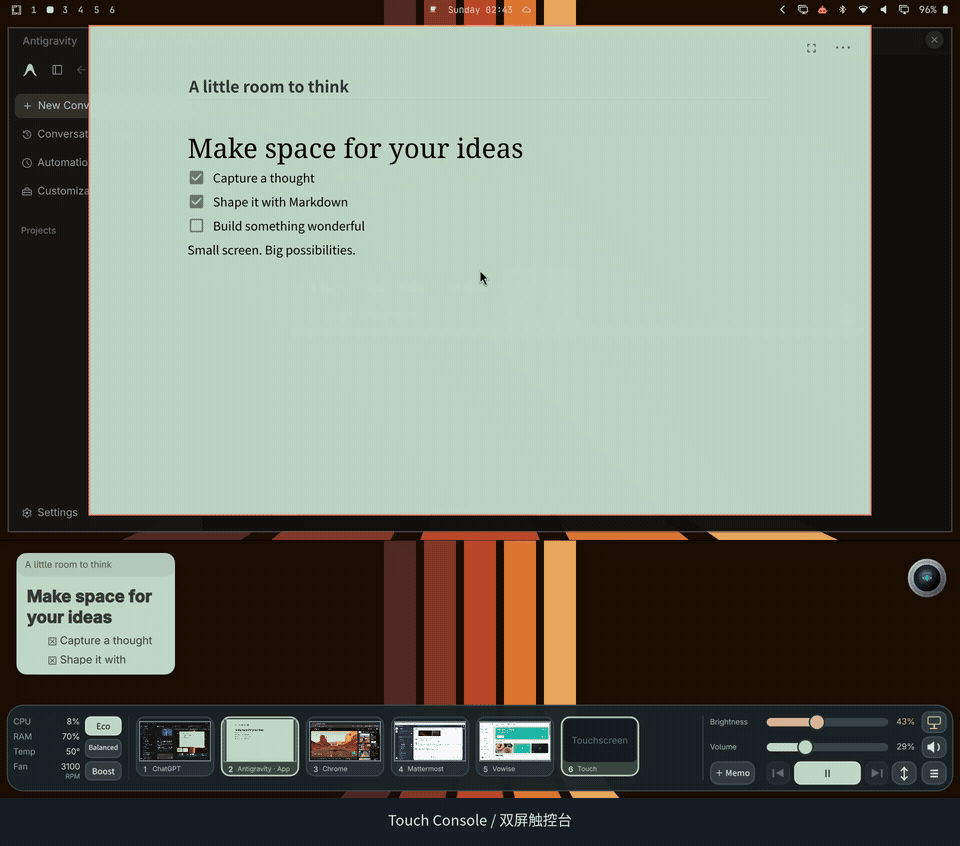
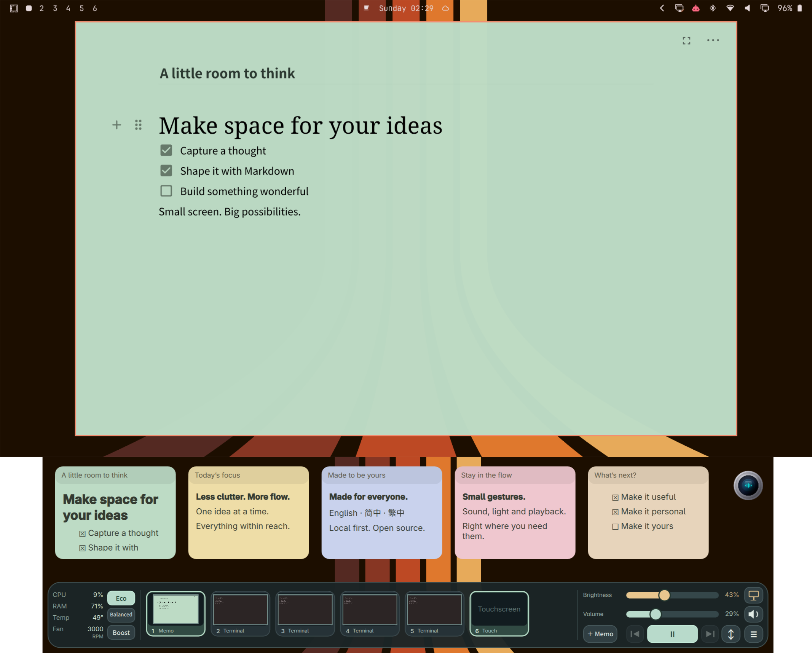
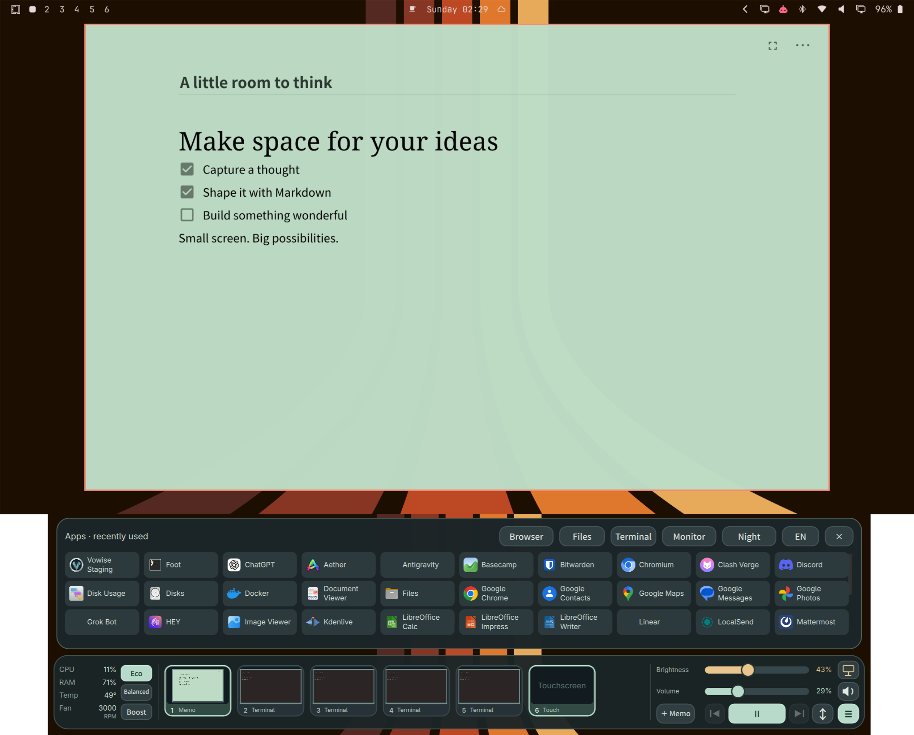

# DuoDeck

**把工作區、桌面控制與本機 Markdown 便箋，放進一個適合觸控的 Omarchy Dock。**

[English](README.md) · [简体中文](README.zh-CN.md) · [繁體中文](README.zh-TW.md)

[](https://github.com/quedulex/duodeck/actions/workflows/check.yml)
[](https://github.com/quedulex/duodeck/releases)
[](LICENSE)
[](https://github.com/quedulex/duodeck/stargazers)

[快速開始](#快速開始) · [功能](#功能) · [設定](#設定) · [參與貢獻](CONTRIBUTING.md) · [版本發佈](https://github.com/quedulex/duodeck/releases)



*29 秒循環動圖，直接在本頁顯示。跨螢幕展開需要另外設定的 ASUS 適配器。*

**[高畫質 MP4 影片](docs/videos/duodeck-demo.mp4)** · [中英文截圖畫廊](docs/MEDIA.md)

## 為什麼使用 DuoDeck？

讓常用桌面操作集中在寬螢幕觸控裝置或筆電副螢幕上。切換工作區、啟動最近使用的應用程式、調整音量與亮度、隨手寫便箋，無需分別搭建多個桌面小工具。

DuoDeck 是原生 **Omarchy Quattro 服務外掛**。Dock 執行於現有 Shell 中，便箋編輯器使用獨立的 Chromium 應用程式視窗。**0.1.2 為預覽版**，適合約 **1100 邏輯像素及以上**的寬螢幕。

## 功能

| 功能 | 可以做什麼 |
| --- | --- |
| 工作區預覽 | 查看縮圖並直接切換工作區；超出寬度時水平捲動。 |
| 最近應用程式啟動器 | 使用適合觸控的應用程式選單，依本機啟動與視窗啟用記錄排序。 |
| 桌面控制 | 調整音量、亮度，靜音，控制媒體播放，切換電源模式。 |
| 系統狀態 | 查看 CPU、記憶體、溫度與風扇讀數，實際項目取決於裝置感測器。 |
| 本機 Markdown 便箋 | 建立彩色卡片，以 Milkdown Crepe 編輯，自動儲存、封存、還原與匯出 Markdown。 |
| 三種介面語言 | 在英語、簡體中文與繁體中文之間切換。 |

## 實際效果

| 工作區預覽與本機便箋 | 應用程式選單與桌面控制 |
| --- | --- |
| [](docs/screenshots/en-01-dual-screen.png) | [](docs/screenshots/en-02-menu.png) |

[操作影片](docs/videos/duodeck-demo.mp4)展示開啟應用程式選單、拖曳卡片、開啟示範便箋、跨螢幕展開與還原。畫面只展開空白 Antigravity 與示範便箋，其他應用程式保留為小型工作區縮圖。影片沒有音訊。

**截圖和影片中的跨螢幕功能使用另外設定的 ASUS 適配器，一般安裝預設不會啟用。** 應用程式圖示、桌布、頂部列與圓形語音元件屬於周邊桌面。目前畫廊提供英文與簡體中文介面截圖；更多全螢幕效果與實機照片見[完整畫廊](docs/MEDIA.md)。

## 快速開始

### 環境需求

需要 **Omarchy Quattro** 與其外掛系統、**Hyprland Lua dispatch API**、Quickshell 和 Python 3。不支援僅提供舊式字串 dispatch 的 Hyprland 版本。

| 功能 | 相依項目 |
| --- | --- |
| 原生 Dock | Quickshell 的 Hyprland、Wayland screencopy、MPRIS 模組；Qt Quick Controls |
| 音量、背光、電源模式 | `wpctl`、`brightnessctl`、`powerprofilesctl` |
| 啟動應用程式與捷徑 | `uwsm-app`、`gtk-launch`、Omarchy 命令；檔案與監控入口分別使用 Nautilus、`btop` |
| Markdown 編輯器 | `chromium`、Python 3；編輯器資源隨外掛提供 |

外掛不會自動安裝相依套件。缺少感測器時顯示短橫線。完整需求與合成器行為見[詳細參考（英語）](docs/REFERENCE.md)。

### 安裝並啟用

```sh
omarchy plugin add https://github.com/quedulex/duodeck --enable
```

只啟用一個實例。已有開發版正在執行時，先用 `omarchy plugin list` 找到它的 ID 並停用。如果曾使用獨立的 `touch-console.service`，請先停止該服務。安裝過程不會自動停止其他服務或改寫桌面設定。

### 使用

1. 點擊工作區卡片切換，開啟應用程式選單啟動程式。
2. 拖曳音量與亮度滑桿；點擊揚聲器靜音。螢幕按鈕透過 DPMS 關閉顯示，不會鎖定螢幕。
3. 點擊 **+ Memo** 建立便箋，再點擊卡片內容開啟編輯器。輸入 Markdown，以 `/` 開啟區塊選單，透過編輯器選單調整顏色、封存、還原或匯出。
4. 點擊語言按鈕循環切換三種語言。語言選擇與最近應用程式排序儲存於本機。

按 Escape 儲存便箋並關閉編輯器；長按卡片開啟內容選單。DPMS 關閉顯示後的喚醒行為取決於 Hyprland 設定。

### 停用或移除

```sh
omarchy plugin disable quedulex.duodeck
omarchy plugin remove quedulex.duodeck
```

移除後保留本機便箋與偏好。若設定了可選跨螢幕適配器，停用前請先還原其視窗。

## 設定

將 `settings.example.json` 複製到 `~/.config/touch-console/settings.json`。設定會在下一次五秒狀態更新時重新讀取。

| 設定項目 | 用途 |
| --- | --- |
| `output` | 指定 Wayland 輸出，例如 `DP-1`；省略時使用 Quickshell 回報的最後一個螢幕。 |
| `workspaces` | 固定顯示數字工作區 ID；其他使用中的正數 ID 會自動加入。 |
| `backlights` | 指定 `/sys/class/backlight` 下的背光裝置；為空時調整所有裝置。 |

外掛不會自動改變螢幕配置或快捷鍵。可選跨螢幕適配器僅執行你明確設定的 argv 命令。更多細節見[設定與使用參考](docs/REFERENCE.md)。

## 本機資料與隱私

- 便箋：`~/.local/state/touch-console/notes.json`。
- 語言與最近應用程式 ID：`~/.local/state/touch-console/preferences.json`。
- 為相容既有資料，保留 `touch-console` 路徑；更換安裝前請備份這些檔案。
- 工作區縮圖僅儲存於記憶體；最近應用程式記錄不包含視窗標題或文件正文。
- 無遙測、雲端帳號、Root 服務或自動套件安裝。
- 便箋編輯器透過具備權杖驗證、僅監聽 `127.0.0.1` 的服務執行，並使用獨立的本機 Chromium 設定目錄。核心編輯器資源可離線使用；使用者插入遠端圖片時可能存取網路。尚未提供本機圖片附件管理。

## 相容性與驗證

開發測試使用 **ASUS UX482**、Omarchy **4.0.4-1**、Hyprland **0.56.2**。正式外掛驗證、隔離的 Python 回歸、Qt Quick 輸入測試與 Chromium 編輯器測試已通過。CI 會重新建置編輯器並執行後端與儲存測試；Ubuntu Runner 缺少 Qt Quick Test 時會跳過對應測試。

發佈預覽版尚未完成原生桌面互動驗收。其他硬體與合成器版本仍需驗證。市場提交與維護者批准尚未完成；公開倉庫不代表已被市場收錄。

## 支持與參與

如果 DuoDeck 對你有幫助，可以點擊倉庫右上角的 **Star** 收藏專案，也支持後續維護。想收到新版本通知，可以選擇 **Watch → Custom → Releases**。

你也可以[回報問題](https://github.com/quedulex/duodeck/issues/new?template=bug_report.yml)、[提出功能建議](https://github.com/quedulex/duodeck/issues/new?template=feature_request.yml)、改善翻譯或提交修正。硬體回饋請附螢幕尺寸、縮放比例、Omarchy/Hyprland 版本與受影響操作。參與方式見[貢獻指南](CONTRIBUTING.md)。

## 維護者與授權

由 [jasoncym](https://github.com/jasoncym) 維護，倉庫歸屬 [Quedulex](https://github.com/quedulex)。採用 [MIT 授權](LICENSE)；編輯器相依套件聲明見 [THIRD_PARTY_NOTICES.md](THIRD_PARTY_NOTICES.md)。
