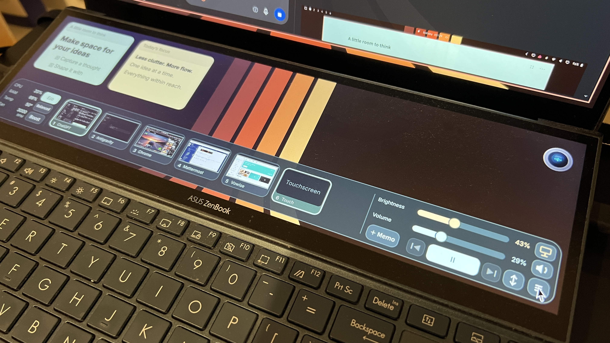
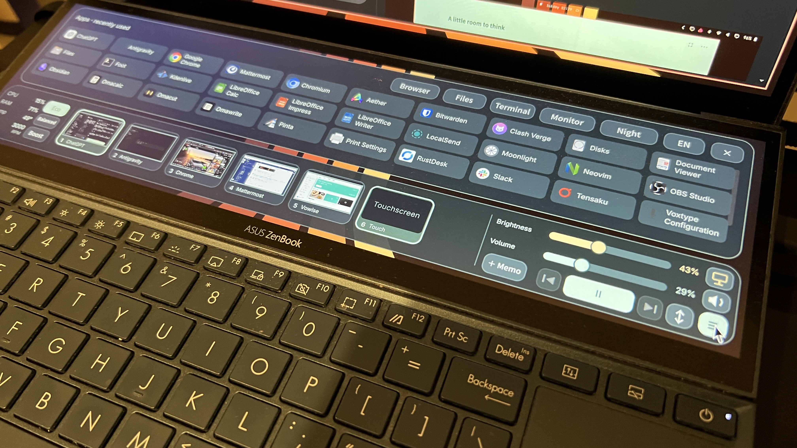
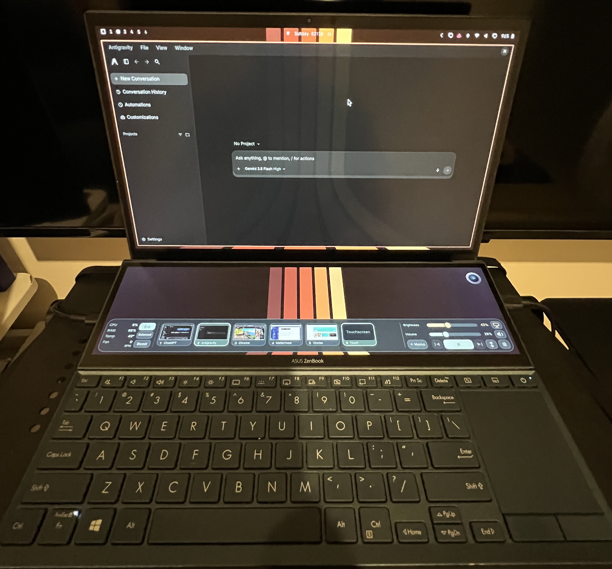
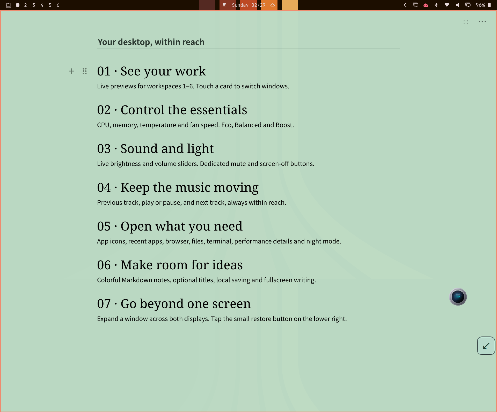
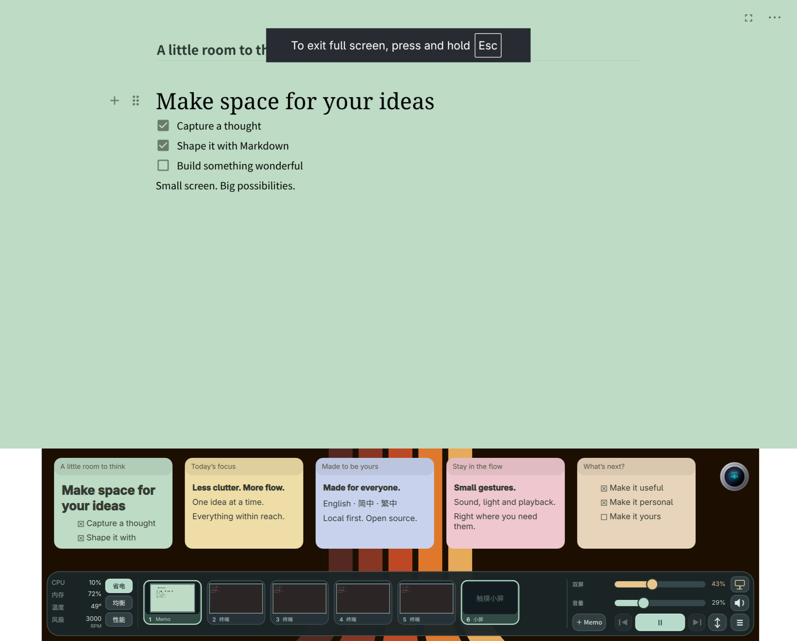
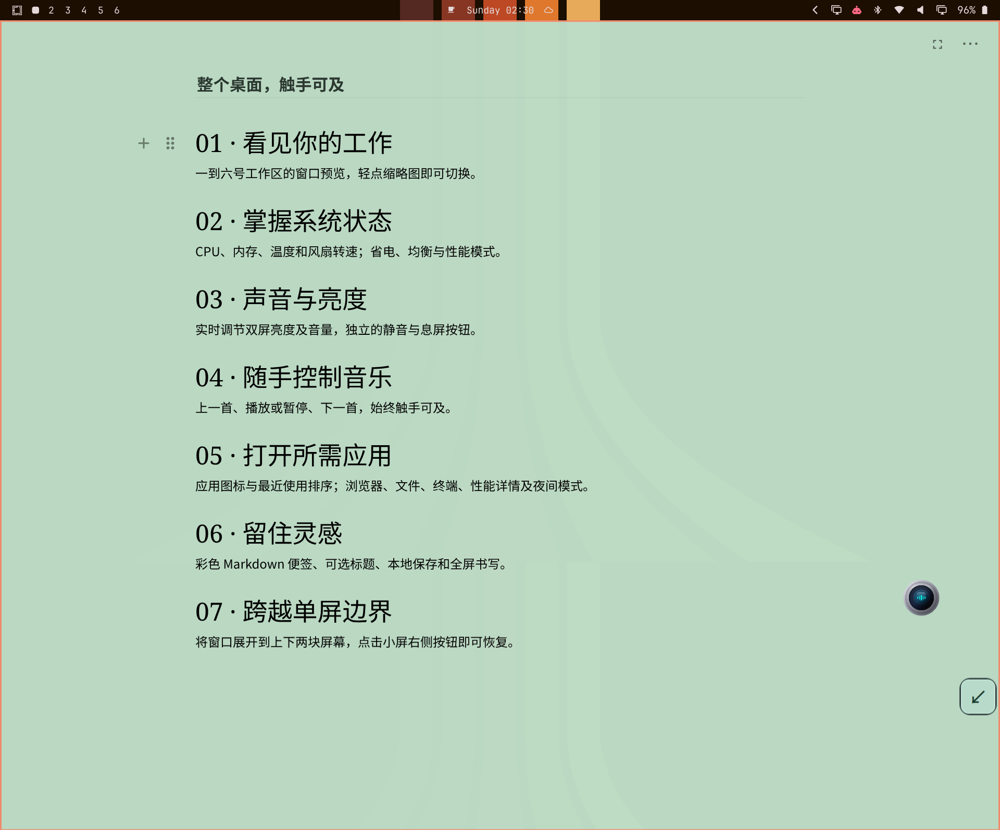

# DuoDeck in action / 实际效果 / 實際效果

[English README](../README.md) · [简体中文](../README.zh-CN.md) · [繁體中文](../README.zh-TW.md)

## Demo video / 操作视频 / 操作影片

**[Watch or download the full 29-second MP4](videos/duodeck-demo.mp4)**

The real recording shows the app menu, dragging a demo card, opening a demo memo, cross-screen spanning and restoration. It stays on workspace 2 with an empty Antigravity window and demo notes. Other apps remain only as small workspace thumbnails. English/Chinese captions are included; no microphone or desktop audio is recorded.

实录展示应用菜单、拖动卡片、打开演示便签、跨屏和恢复。固定在工作区 2，展开画面只有空白 Antigravity 和演示便签，其他应用仅作为小型缩略图保留。含中英文字幕，无麦克风或桌面音频。

## On real hardware / 实机照片 / 實機照片

Photographs supplied by the owner. JPEG metadata was removed without modifying compressed image data.

### Memos and desktop controls / 便签与桌面控制

### Expanded app launcher / 展开的应用菜单

### Complete dual-screen device / 双屏设备全貌

## English interface

These captures show the upper and lower displays together, using demo content. Click a screenshot to inspect the full-resolution file.

### Desktop, workspaces 1–6 and memos

### Apps and quick actions

### Fullscreen editor

### Optional spanning adapter

## 简体中文界面

每张截图同时包含上下两块屏幕，使用演示内容。点击图片可以查看原始分辨率。繁體中文版文件共用此中英文画廊，尚无繁體介面截圖。

### 双屏桌面、工作区 1–6 与便签

### 应用菜单与快捷操作

### 主屏全屏编辑器

### 可选跨屏适配器

## Scope of the demonstration / 展示范围

Captured on 2026-10-11 using an ASUS UX482 development installation. Normal digital captures use 1.5× scaling on the upper display and approximately 1.667× on the lower display. The optional spanning demonstration uses 1.5× on both displays.

Cross-screen spanning depends on a separately configured ASUS-specific adapter; it is not enabled in generic installations. The full-screen memo editor is part of the plugin. Application logos, wallpaper, top bar and the circular voice widget belong to their respective apps or the surrounding desktop. Application ordering/pinning is local configuration. Demonstration footage documents the development installation and does not replace acceptance testing of the published package.

截图和视频来自 ASUS UX482 开发安装。跨屏依赖单独配置的硬件适配器；普通安装默认不启用。便签全屏编辑属于插件功能。应用图标、壁纸、顶部栏、圆形语音组件不是本插件提供的功能；应用排序与置顶属于本地配置。开发安装的效果展示不替代发布包的真实验收。
